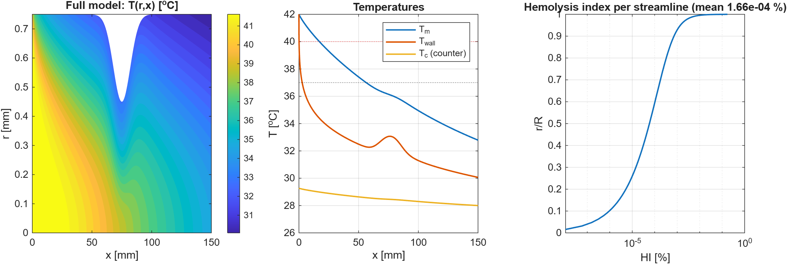
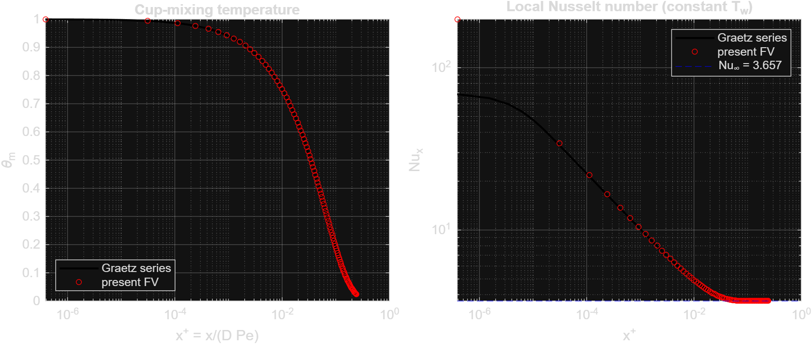
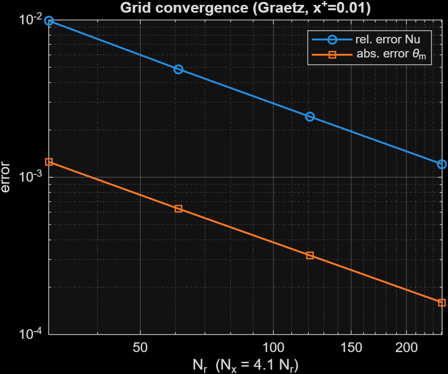
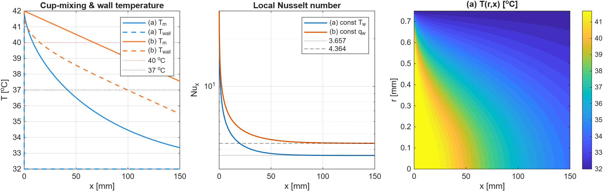
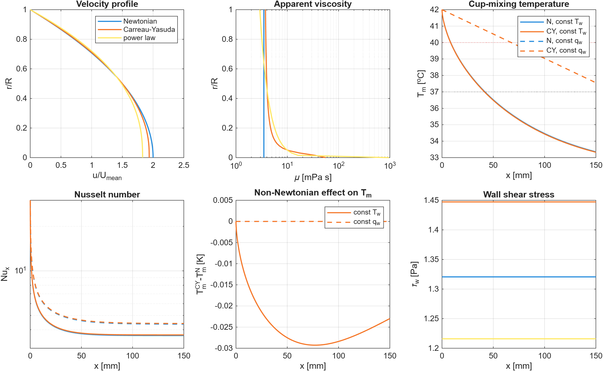
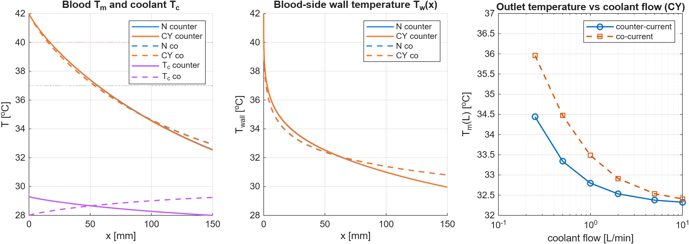
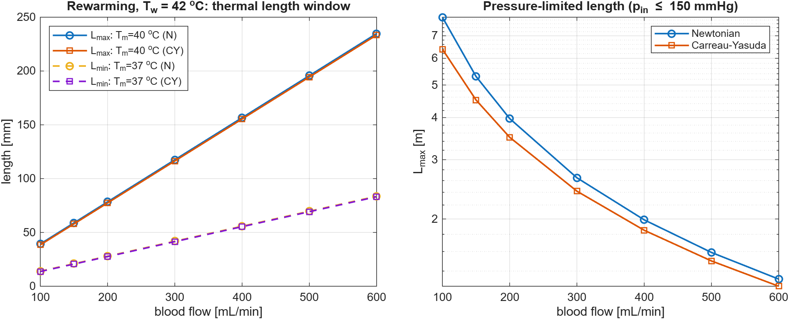
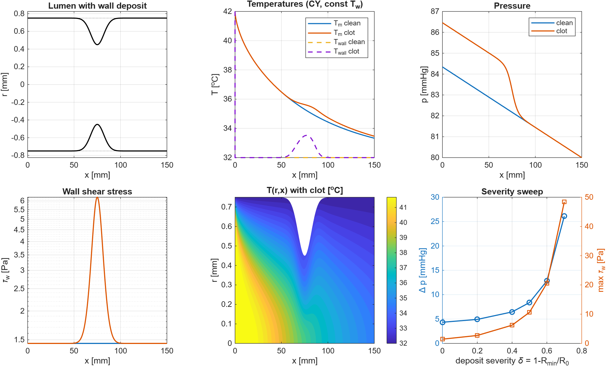
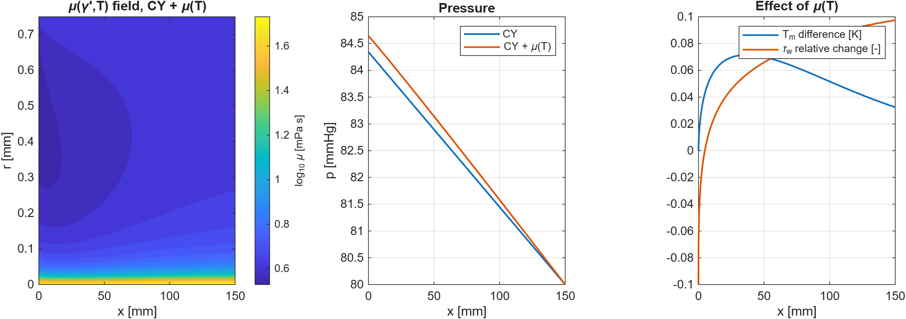
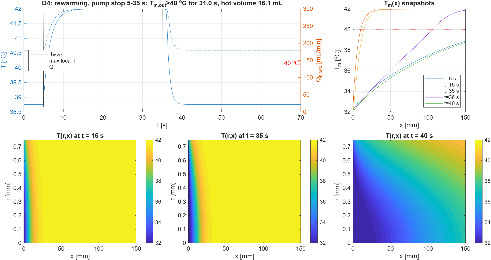

<div align="center">

# Cardioplegia Heat Exchanger: Thermo-Fluid Model

**A verified 2-D laminar model of blood heat transfer and flow in the tubes of a cardioplegia heat exchanger, with a transient extension for digital-twin use**




</div>

---

## Table of contents

1. [Overview](#overview)
2. [Key features](#key-features)
3. [Repository structure](#repository-structure)
4. [Getting started](#getting-started)
5. [Mathematical formulation](#mathematical-formulation)
6. [Verification](#verification)
7. [Results](#results)
8. [Transient model](#transient-model-digital-twin-core)
9. [Limitations and roadmap](#limitations-and-roadmap)
10. [Author](#author)

---

## Overview

During cardiac surgery, cardioplegia solution and blood pass through a heat exchanger
that must cool or rewarm them **without overheating the blood** (protein damage above
about 42 °C), **without excessive pressure** and **without damaging shear stress**.

This project solves the steady, laminar, axisymmetric heat-transfer problem for blood in
the exchanger tubes (problem items **(a)–(i)**) and extends it to a **time-dependent
model** that can serve as the physics core of a digital twin. The model is fast (under
a second for most runs) and every component is checked against analytical solutions.

> [!NOTE]
> The geometry and flow values in [`matlab/cp_params.m`](matlab/cp_params.m) are
> **generic placeholders** (40 tubes, ID 1.5 mm, L = 150 mm, 300 mL/min). Enter the real
> device's tube count, inner diameter, length, wall material, water flow and h_c, then
> re-run. Everything else adapts automatically.

---

## Key features

| Capability | Details |
|---|---|
| **Blood rheology** | Newtonian, Carreau–Yasuda (shear-thinning) and power law, each with optional temperature-dependent viscosity |
| **Wall conditions** | Constant wall temperature, constant heat flux, or a fully coupled coolant circuit (co- or counter-current) |
| **Safety metrics** | Cup-mixing temperature, safe-length limits (40 °C / 37 °C), local peak temperature vs 42 °C |
| **Hydraulics** | Pressure distribution, wall shear stress, hemolysis index (Giersiepen) |
| **Wall deposits** | Clot / thrombus layer that narrows the lumen and adds thermal resistance |
| **Viscous dissipation** | Included in the energy equation and checked against an exact energy balance |
| **Transient model** | Any input can vary in time: steps, pump stops, pulsatile flow; gives transfer functions for control design |
| **Verification** | Graetz, Poiseuille, power-law Nusselt numbers, grid and time convergence, energy conservation |

---

## Repository structure

```
Cardioplegia_Device/
├── matlab/                     # Source code
│   ├── cp_params.m             # All parameters (geometry, properties, rheology, BCs, grid)
│   ├── cp_solve.m              # Steady 2-D marching solver (energy + momentum + coolant)
│   ├── cp_solve_transient.m    # Transient blood + wall + water solver
│   ├── cp_velocity.m           # Fully developed velocity for any rheology
│   ├── cp_shear_rate.m         # Shear-rate from stress (constitutive inversion)
│   ├── cp_viscosity.m          # Viscosity laws × temperature factor a_T(T)
│   ├── cp_radius.m             # Lumen radius R(x) with optional clot
│   ├── cp_crossing.m           # Position where T_m crosses a given level
│   ├── cp_validate.m           # Steady verification suite (V1–V6)
│   ├── cp_validate_transient.m # Transient verification suite (TV1–TV4)
│   ├── run_all_cases.m         # Cases (a)–(i), sweeps and design maps
│   ├── run_transient_cases.m   # Digital-twin scenarios (D1–D5)
│   ├── make_figures.m          # Figure generation
│   └── run_everything.m        # One-click: validate + run all + figures
├── results/                    # Figures (PNG), tables (CSV) and run logs
└── README.md
```

---

## Getting started

### Requirements

- MATLAB (base installation; no toolboxes are required).

### Run everything

```matlab
cd matlab
run_everything      % steady + transient validation and all cases (~20 min)
```

All outputs are written to `results/`.

### Single run

```matlab
p = cp_params;
p.rheology         = 'carreau-yasuda';
p.bc               = 'coupled';
p.flow_arrangement = 'counter';
p.Tdep             = true;     % temperature-dependent viscosity
p.viscDiss         = true;     % viscous dissipation

S = cp_solve(p);
plot(S.x, S.Tm)                % cup-mixing temperature along the tube
cp_crossing(S.x, S.Tm, 40)     % position where T_m = 40 °C
```

### Outputs

| File | Contents |
|---|---|
| `summary_cases.csv` | Key results for every case |
| `d_coolant_sweep.csv` | Coolant-flow sweep (item d) |
| `e_design_map.csv` | Safe-length design map (item e) |
| `g_clot_severity.csv` | Clot severity sweep (item g) |
| `h_dissipation.csv` | Viscous dissipation study (item h) |
| `F1`–`F9`, `FT1`–`FT4` | Steady and transient result figures |
| `V2`, `V6`, `VT3`, `VT4` | Verification figures |
| `run_log.txt`, `transient_log.txt` | Full console logs |

> `all_results.mat` and `transient_results.mat` (~20 MB each) are not tracked in git.
> Running `run_everything` regenerates them.

---

## Mathematical formulation

### Assumptions

- Steady, laminar flow (Re ≈ 30) in an axisymmetric tube of radius R(x) with R′(x) ≪ 1,
  so the **lubrication approximation** holds.
- Hydrodynamically developed: the entrance length 0.05 Re D ≈ 2 mm is under 2 % of L.
- Thermally developing (Graetz problem). Axial conduction is neglected (Pe = Re·Pr ≈ 800).
- ρ, c_p and k are constant; μ = μ(γ̇, T).

### Momentum (lubrication approximation)

$$\frac{1}{r}\frac{\partial}{\partial r}\left(r\,\tau_{rx}\right)=\frac{dp}{dx}
\;\Rightarrow\; \tau(r,x)=\tau_w(x)\,\frac{r}{R(x)},\qquad
\tau=\mu(\dot\gamma,T)\,\dot\gamma,\quad \dot\gamma=-\frac{\partial u}{\partial r}$$

$$u(r,x)=\int_r^{R}\dot\gamma\,dr',\qquad 2\pi\int_0^R u\,r\,dr = Q_t
\;\;\Rightarrow\;\;\tau_w(x),\quad \frac{dp}{dx}=-\frac{2\tau_w}{R}$$

The radial velocity v follows from continuity and is carried by the stream function.

### Rheology

| Model | Viscosity |
|---|---|
| Newtonian | $\mu=\mu_N\,a_T$ |
| Carreau–Yasuda (Boyd 2007; Cho & Kensey 1991) | $\mu=a_T\left[\mu_\infty+(\mu_0-\mu_\infty)\left(1+(\lambda\dot\gamma)^a\right)^{(n-1)/a}\right]$ |
| Power law (comparison only) | $\mu=a_T K\dot\gamma^{\,n-1}$ |
| Temperature factor (item i) | $a_T=\exp[-\beta(T-T_{ref})]$, β = 0.021 K⁻¹ (≈ 2 %/K) |

Carreau–Yasuda parameters: μ₀ = 0.056 Pa·s, μ∞ = 0.00345 Pa·s, λ = 1.902 s, n = 0.22, a = 1.25.

### Energy equation

$$\rho c_p\left(u\frac{\partial T}{\partial x}+v\frac{\partial T}{\partial r}\right)=\frac{1}{r}\frac{\partial}{\partial r}\left(k r\frac{\partial T}{\partial r}\right)+\underbrace{\mu\dot\gamma^{2}}_{\text{dissipation}}$$

In the mapped coordinate η = r/R(x), which follows a clotted wall exactly:

$$\rho c_p\left(u\,T_x-\frac{G_x}{R^2\eta}T_\eta\right)=\frac{1}{R^2\eta}\left(k\eta T_\eta\right)_\eta+\mu\dot\gamma^2,
\qquad G(\eta,x)=R^2\int_0^\eta u\,\eta'\,d\eta'$$

G is the Stokes stream function divided by 2π. The G_x term is the exact form of radial
convection: it vanishes for self-similar profiles and becomes non-zero under a clot or
when μ(T) changes.

**Inlet and symmetry:** T(r,0) = T_in; ∂T/∂r = 0 at r = 0.

### Wall conditions

| Case | Condition at the blood–wall interface |
|---|---|
| (a) Constant wall temperature | $T(R_0,x)=T_w$ |
| (b) Constant heat flux | $-k\,\partial T/\partial r=q_w$ (q_w > 0 cools the blood) |
| (d) Coupled coolant | $-k\,\partial T/\partial r = U\,(T_{wall}-T_c(x))$ |

For (d) the coolant obeys

$$\dot m_c c_{p,c}\frac{dT_c}{dx}=\pm\,2\pi R\,U\,(T_{wall}-T_c)$$

(+ co-current, − counter-current with T_c(L) = T_c,in, solved by secant shooting), with series resistance

$$\frac1U=\frac{R\ln(R_0/R)}{k_{clot}}+\frac{R\ln(R_o/R_0)}{k_{wall}}+\frac{R}{R_o h_c}$$

The first term is the thrombus layer (item g).

### Derived quantities

- **Cup-mixing temperature:** $T_m(x)=\dfrac{\int_0^R uTr\,dr}{\int_0^R u r\,dr}$. The safe length is
  the position where T_m reaches 40 °C (and 37 °C); the local maximum is checked against 42 °C.
- **Nusselt number:** $Nu=2Rq_w/[k(T_m-T_{wall})]$
- **Pressure:** $p(x)=p_{out}+\int_x^L 2\tau_w/R\,dx'$, with limits p_in ≤ 150 mmHg and τ_w ≤ 150 Pa
- **Hemolysis:** Giersiepen power law $HI=C\,t^{\alpha}\tau^{\beta}$, accumulated along streamlines
  (linearised Garon–Fariñas form) and flow-averaged
- **Global energy balance:** $\rho c_pQ\Delta T_m=-\int2\pi Rq_w\,dx+\iint\mu\dot\gamma^2dA\,dx$,
  satisfied to better than 2·10⁻⁴ in every case

### Numerical method

- Finite volume in η on a wall-clustered grid (η = sin(πs/2), 101 nodes)
- Fully implicit marching in x on an inlet-clustered grid (x = L s², 500 steps) to resolve
  the Graetz entrance singularity
- Sparse direct solve per step; coolant temperature solved implicitly with the blood
- Picard iteration when μ = μ(T)
- Carreau–Yasuda: τ = μ(γ̇)γ̇ inverted by bracketed Newton iteration in log γ̇; τ_w from a
  monotone scalar root of Q(τ_w) = Q_t
- **Run time (laptop):** under 1 s for Newtonian or CY; up to 1–2 min for CY + μ(T) +
  counter-current shooting

---

## Verification

Steady solver (`cp_validate.m`):

| Test | Result |
|---|---|
| V1 Poiseuille / power-law velocity and τ_w vs analytical | error ≤ 4·10⁻⁵ |
| V1 CY with μ₀ = μ∞ reduces to Poiseuille | 3·10⁻⁵ |
| V2 Graetz problem (80-mode eigen-series), θ_m(x) | max error 5.5·10⁻⁴ |
| V2 Nu∞, constant T_w | **3.6567** (exact 3.6568) |
| V3 Nu∞, constant flux | **4.3635** (exact 48/11 = 4.3636) |
| V4 Power law, constant flux, Nu∞ = 8(5n+1)(3n+1)/(31n²+12n+1) | n = 0.5: 4.7456 vs 4.7458; n = 0.708: 4.5320 vs 4.5322 |
| V5 Adiabatic wall + dissipation, ΔT_m = Δp/(ρc_p) | relative error 1.6·10⁻⁴ |
| V6 Grid convergence | first order; default grid error 0.25 % in Nu, 3·10⁻⁴ in θ_m |

<p align="center">
  
  
</p>

---

## Results

Results below use the **placeholder device**. The *cool* scenario cools locally heated
blood from 42 °C (wall 32 °C in (a), q_w = 3000 W/m² in (b), coolant 28 °C at 2 L/min in
(d)). The *rewarm* scenario heats blood from 32 °C with water/wall at 42 °C, which is
where the upper length limit of item (e) appears.

| Item | Key finding |
|---|---|
| **(a)** Constant T_w, Newtonian | T_m(L) = 33.35 °C; T_m ≤ 40 °C after **8.5 mm**, 37 °C at **41.8 mm**; Nu → 3.657 |
| **(b)** Constant q_w, Newtonian | T_m falls linearly: 40 °C at 67.5 mm, outlet 37.55 °C; Nu → 4.367 |
| **(c)** Carreau–Yasuda | Blunter profile; τ_w and Δp **+9.6 %**, Nu∞ +1 % (3.691 / 4.409), T_m changes < 0.03 K. A power law under-predicts τ_w by 16 % relative to CY. |
| **(d)** Coupled coolant | Counter-current outlet 32.53 °C vs co-current 32.91 °C at 2 L/min; at 0.25 L/min the gap is 1.5 K. Wall temperature is no longer uniform. |
| **(e)** Safe length (rewarm) | **L_max = 117 mm** (Newtonian) / 116 mm (CY) at 300 mL/min, growing linearly with flow (39 mm at 100 mL/min, 235 mm at 600 mL/min). Under constant-flux rewarming T_m stays < 40 °C but the **local wall-side blood reaches 42.8 °C**. |
| **(f)** Pressure | Δp ≈ 4 mmHg, p_in ≈ 84 mmHg (limit 150). Pressure-limited length 1.3–8 m, so pressure does not bind for a clean device. τ_w ≈ 1.4 Pa. |
| **(g)** Wall deposit, δ = 40 % | Δp 4.3 → 6.5 mmHg; max τ_w 1.4 → 6.2 Pa; HI ×2.3; T_m(L) +0.14 K (thrombus insulates). At δ = 70 %: Δp 26 mmHg, τ_w 48 Pa. |
| **(h)** Viscous dissipation | Br ≈ 4·10⁻⁶, ΔT_m ≈ 3·10⁻⁵ K: negligible at clinical flows. |
| **(i)** Temperature-dependent μ | Cooling raises viscosity: Δp **+6.9 %**, outlet τ_w +10 %, 37 °C length 41.4 → 42.5 mm |
| **Full model** | CY + μ(T) + dissipation + clot + counter-current: T_m(L) = 32.79 °C, p_in = 86.8 mmHg, max τ_w = 6.6 Pa, HI = 1.7·10⁻⁴ % |

### Figures

| | |
|:---:|:---:|
| <br>**F1** Cases (a), (b) | <br>**F2** Rheology (c) |
| <br>**F3** Coupled coolant (d) | <br>**F4b** Design map (e, f) |
| <br>**F6** Wall deposit (g) | <br>**F8** μ(T) (i) |

All figures are in [`results/`](results).

---

## Transient model (digital-twin core)

`cp_solve_transient(p, tr)` extends the model in time. Every operating input can be any
function of time.

```matlab
p = cp_params;
p.rheology = 'carreau-yasuda';  p.bc = 'coupled';  p.flow_arrangement = 'counter';

tr.t_end   = 40;  tr.dt = 0.05;
tr.Tc_in   = @(t) 28 - 8*(t >= 2);                 % water inlet step
tr.Q_total = @(t) 5e-6*(1 + 0.4*sin(2*pi*t));      % pulsatile blood flow

S = cp_solve_transient(p, tr);
plot(S.t, S.Tm_out)
```

- **Inputs:** `T_in(t)`, `Q_total(t)`, `Tc_in(t)`, `Qc_total(t)`, `T_wall(t)`, `q_wall(t)`
- **Outputs:** `Tm_out`, `Tc_out`, `Tmax`, `Twall_max`, `p_in_mmHg`, `dp_mmHg`, `Qheat_W`,
  `tau_w_max`, `Tm_xt`, `Tc_xt`, and full T(r,x) snapshots at `tr.save_times`

### Equations

$$\rho c_p\left(\frac{\partial T}{\partial t}+u\,T_x-\frac{G_x}{R^2\eta}T_\eta\right)=\frac{1}{R^2\eta}(k\eta T_\eta)_\eta+\mu\dot\gamma^2\qquad\text{(blood)}$$

$$\rho_w c_w A_w\frac{\partial T_s}{\partial t}=2\pi R\left[U_1(T_{wall}-T_s)-U_2(T_s-T_c)\right]\qquad\text{(tube wall)}$$

$$\rho_c c_{p,c}A_c\frac{\partial T_c}{\partial t}\pm\dot m_c c_{p,c}\frac{\partial T_c}{\partial x}=2\pi R\,U_2(T_s-T_c)\qquad\text{(water)}$$

with $1/U_1 = R_{clot}+R\ln(R_m/R_0)/k_w$ and $1/U_2 = R\ln(R_o/R_m)/k_w + R/(R_o h_c)$
(R_m = mid-wall radius). At steady state these reduce exactly to the series resistance U above.

**Quasi-steady momentum:** the viscous diffusion time R²/ν ≈ 0.2 s is much shorter than the
thermal times (residence 2.1 s, radial diffusion 4.3 s). The Womersley number at 1 Hz is ≈ 1,
so pulsatile results are a first-order approximation.

**Numerics:** same finite-volume / upwind space discretisation as the steady solver; BDF2
in time (backward Euler optional) with LU reuse while flow rates are constant;
counter-current water solved simultaneously (no shooting); μ(T) lagged one step.
40 s of simulated time runs in about 5–10 s (61 × 200 grid).

### Transient verification (`cp_validate_transient.m`)

| Test | Result |
|---|---|
| TV1 Steady limit vs `cp_solve` | 10⁻¹³–10⁻¹² K |
| TV1 Counter-current vs fine reference | first order (0.034 → 0.0036 K, Nx 100 → 800) |
| TV2 Discrete energy conservation | relative residual 8·10⁻¹³ |
| TV3 Poiseuille residence-time distribution | L1 error 7.4·10⁻³ → 1.1·10⁻³ |
| TV4 Temporal accuracy (BDF2) | observed order ≥ 2 |

### Digital-twin scenarios (`run_transient_cases.m`)

All use cooling with CY blood, counter-current water and wall heat capacity.

| Scenario | Result |
|---|---|
| **D1** Water inlet step 28 → 20 °C | T_m,out 32.54 → 27.14 °C. FOPDT fit: K = 0.675, θ = 0.27 s, τ = 1.11 s; 95 % settled in 3.1 s |
| **D2** Blood inlet step +1 K | K = 0.325, θ = 1.13 s, τ = 0.72 s, giving G(s) = K e^{−θs}/(τs+1) for controller design |
| **D3** Blood flow +50 % | T_m,out 32.54 → 34.51 °C (τ ≈ 0.6 s); p_in 84.3 → 86.3 mmHg |
| **D4** Pump stop during rewarming | Outlet exceeds 40 °C **0.7 s after the stop**, stays above 40 °C for 31 s, peaks at 42 °C. On restart a **hot bolus of 16 mL above 40 °C** reaches the patient. |
| **D5** Pulsatile roller pump (1 Hz, ±40 %) | T_m,out ±0.22 °C, p_in ±1.6 mmHg |

<p align="center">
  
</p>

> A sudden step input causes a small BDF2 overshoot in the water outlet temperature
> (≈ 0.4 K, under 1 s). Use `tr.scheme = 'BE'` or a smoothed input if that matters.

---

## Limitations and roadmap

1. **Real geometry.** Replace the placeholders in `cp_params.m`. For a pleated or annular
   blood channel instead of tubes, only `cp_velocity` (the cross-section) needs a variant.
2. **Water-side coefficient.** h_c is a constant input; replace it with a shell-side
   correlation or manufacturer data.
3. **Digital twin.** Connect the transient model to measured inlet/outlet temperatures and
   pressures (extended or ensemble Kalman filter), fit h_c and clot severity from bench
   data, and use the FOPDT transfer functions for model-predictive control of water
   temperature and flow.
4. **Out of scope.** The oxygenator (two-phase gas transfer) is a separate problem.

---

## Author

**Debanjan Kakati**: [GitHub @DEBANJAN-KAKATI](https://github.com/DEBANJAN-KAKATI)

If you use this model in your work, please cite this repository.
